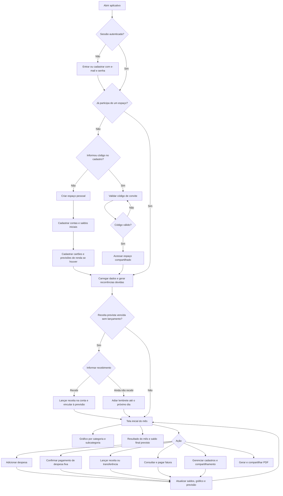
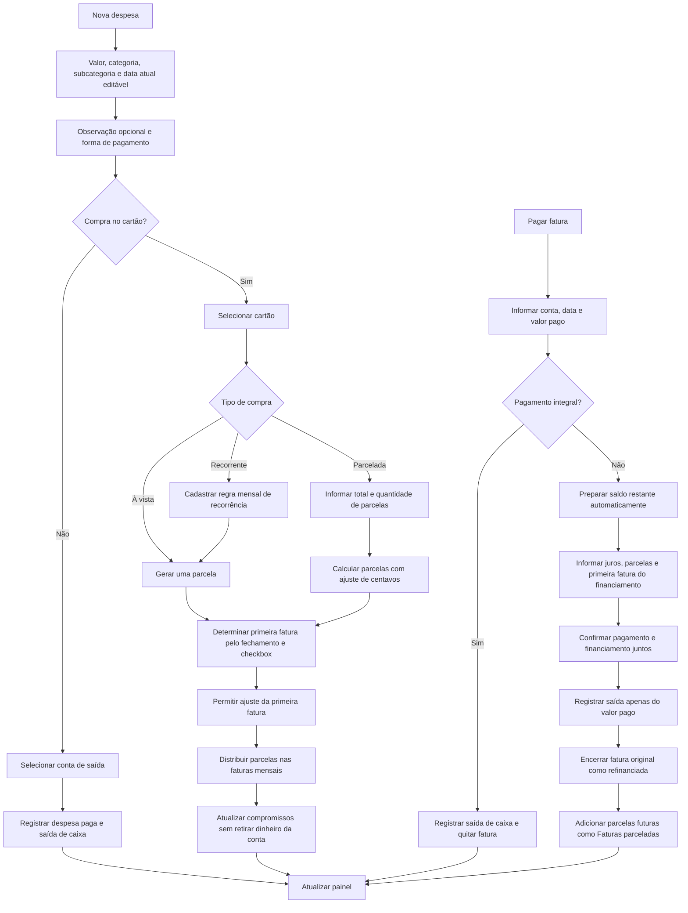
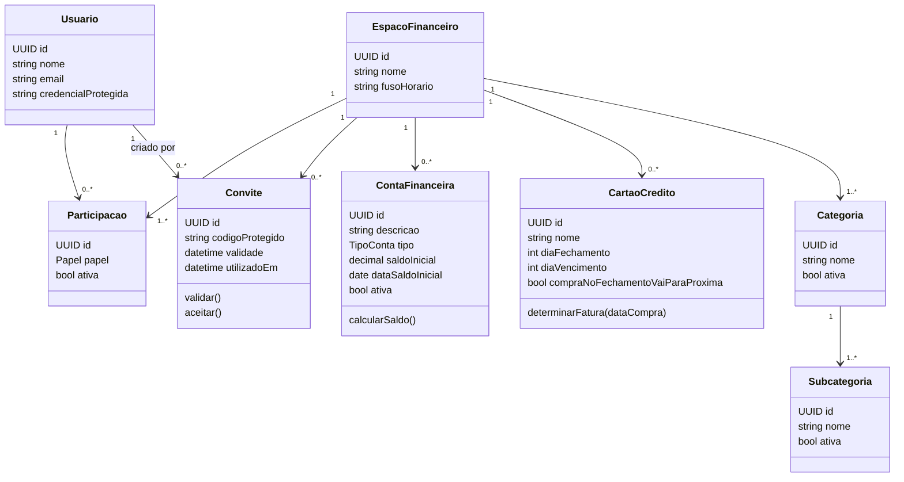
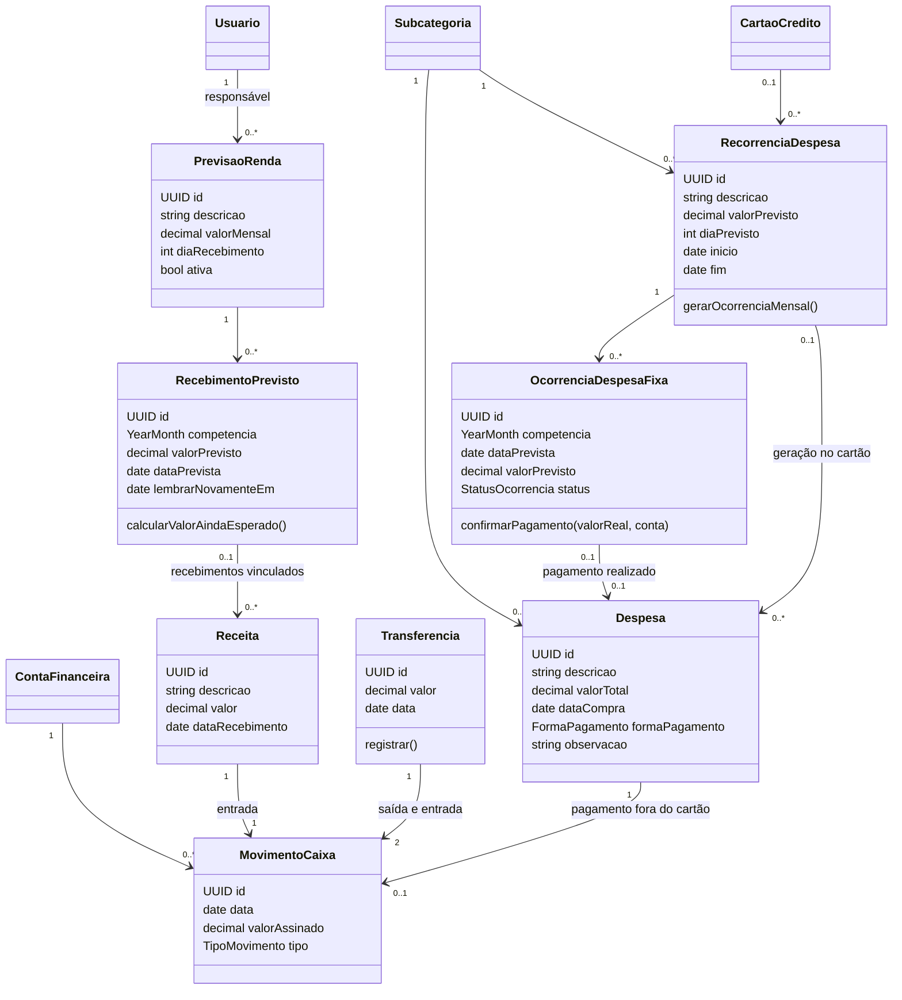
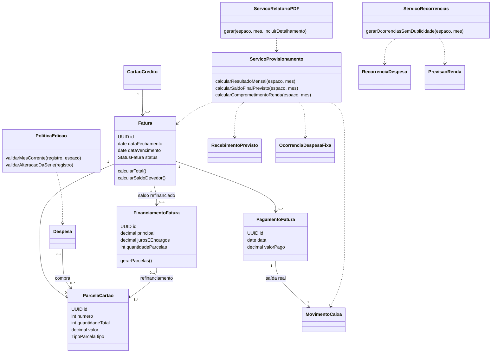

# Modelagem do aplicativo de controle financeiro

Versão inicial — 30/09/2026. Documento de especificação; não representa uma implementação.

Atualização de contexto em 07/10/2026: tecnologias aprovadas em [ADR-0001](adr/0001-arquitetura-inicial.md), critérios em [critérios de aceite](criterios-aceite.md). Refinamentos ainda não aprovados estão em [decisões pendentes](decisoes-pendentes.md); em particular, a fórmula do resultado após refinanciamento aguarda essa decisão. O restante deste documento preserva a modelagem inicial.

## Escopo

Aplicativo Android, conectado à internet, com autenticação por e-mail e senha e dados no servidor. Cada pessoa possui seu login e participa de um espaço financeiro compartilhável por código de convite. Conta financeira significa conta bancária ou dinheiro em espécie; não significa login.

Refinamento de 11/10/2026: cada login pertence a um único espaço financeiro por vez. No cadastro, o código de convite é opcional: com código, a pessoa entra no espaço compartilhado; sem código, o aplicativo cria seu espaço pessoal. Após entrar, o aplicativo abre esse espaço diretamente, sem escolha entre vários espaços. Se um participante sair ou for removido, pode entrar em outro espaço por convite ou criar um espaço próprio, sem manter duas participações simultâneas.

## Fluxograma principal

## Fluxograma de despesas e cartões

O pagamento parcial e a destinação do saldo restante são confirmados juntos. Cancelar essa operação antes da confirmação não pode deixar uma fatura encerrada sem o registro do saldo devedor. As compras originais permanecem no histórico; a fatura é encerrada por pagamento e refinanciamento, não por uma saída fictícia de dinheiro.

## Diagrama de classes — identidade e cadastros

Os diagramas abaixo compõem um único modelo, dividido para facilitar a leitura. As classes de domínio descrevem os dados e responsabilidades; não exigem uma tecnologia específica.

O criador do espaço é administrador. Participantes ativos podem consultar e registrar movimentações; somente o administrador gerencia participantes e convites. O código dá acesso ao espaço, não à senha ou à identidade de outra pessoa. Categorias iniciais são copiadas para cada espaço e podem ser personalizadas.

## Diagrama de classes — movimentações e previsões

Cada registro financeiro pertence a um espaço e registra quem o criou. Essas relações comuns foram omitidas deste diagrama para legibilidade. A categoria da despesa é obtida pela subcategoria escolhida, impedindo combinações inconsistentes.

Uma recorrência fora do cartão gera previsões de despesas fixas; a confirmação gera a despesa paga. Uma recorrência no cartão gera compras automaticamente, uma única vez por período. Receita avulsa aumenta o caixa, mas não quita automaticamente uma previsão sem vínculo. O lançamento solicitado pelo lembrete já recebe esse vínculo.

## Diagrama de classes — faturas e serviços

Cada parcela tem uma única origem: compra ou financiamento. Parcelamentos antigos geram somente as parcelas restantes; valores históricos já pagos não alteram o saldo inicial. Faturas e parcelas usam o mês de vencimento como competência do compromisso.

## Regras de cálculo e integridade

1. **Saldo da conta:** saldo inicial mais movimentos de caixa posteriores ao marco inicial. Comprar no cartão não gera saída de caixa; pagar a fatura gera. Transferências geram duas movimentações na mesma operação e não afetam o resultado consolidado.
2. **Resultado previsto do mês:** renda prevista menos despesas fora do cartão já pagas, despesas fixas ainda pendentes e compromissos de cartão do mês. Uma despesa fixa paga substitui sua previsão pelo valor real, sem duplicação.
3. **Saldo final previsto:** saldo atual consolidado mais recebimentos vinculados ainda esperados no mês menos despesas fixas pendentes e valores de faturas ainda a pagar no mês. Receita recebida já está no saldo e não entra outra vez como expectativa. Valores ainda esperados nunca ficam negativos.
4. **Financiamento de fatura:** o gráfico mantém as compras no mês original e mostra o financiamento nas competências futuras em “Faturas parceladas”. Essa é uma visão de compromissos mensais. Em totais de consumo de vários meses, principal refinanciado não é nova compra; juros e encargos aparecem separados. O PDF distingue consumo, compromissos e fluxo de caixa.
5. **Gráfico do cartão:** compras no crédito entram em Gastos do mês pelo mês da fatura atribuída, inclusive enquanto aberta. Continuam no mesmo mês após fechamento e pagamento; pagar a fatura reduz o caixa e não cria outra despesa no gráfico.
6. **Fechamento:** compras após o fechamento vão para a fatura seguinte; no próprio dia, vale o checkbox do cartão. Cada fatura guarda datas concretas, além dos dias configurados no cartão. Proposta técnica: em meses sem o dia cadastrado, usar o último dia do mês; vencimento deve ocorrer após o fechamento correspondente.
6. **Centavos:** usar valores monetários exatos, sem ponto flutuante binário. O ajuste de arredondamento fica na última parcela, garantindo que a soma corresponda ao total.
7. **Histórico:** edição e exclusão financeira somente no mês corrente do espaço. Em séries, mudanças podem atingir a ocorrência atual e as futuras, preservando meses anteriores. Parcelas antigas já encerradas não podem ser reescritas ao alterar o restante da série. Cadastros usados no histórico devem ser desativados em vez de apagados.
8. **Automação:** geração mensal de previsões e recorrências acontece no servidor, com proteção contra duplicação. Abrir o app consulta os dados atualizados; não é necessário manter o celular aberto para gerar compromissos.
9. **Compartilhamento:** toda consulta e alteração exige participação ativa no espaço. Pagamentos, transferências e refinanciamentos são gravados como operações indivisíveis, evitando saldos parciais e duplicação por toques repetidos.
10. **Lembretes:** ao atingir a data prevista, solicitar o recebimento se houver pendência vinculada. “Ainda não recebi” posterga a cobrança até o dia seguinte, sem criar receita. Permitir informar valor real diferente do previsto e encerrar a previsão quando o recebimento estiver concluído.

## Relatório PDF

Cabeçalho com espaço, mês e data de geração; resumo da renda prevista e recebida; resultado mensal e saldo final projetado; gráfico por categoria; despesas fixas pagas e pendentes; faturas e financiamentos; saldos atuais por conta. Detalhamento de despesas opcional. Para meses anteriores, os saldos devem ser calculados na data de encerramento do período e identificados como históricos, sem apresentar o saldo atual como se fosse daquele mês.

## Limites desta fase

Este é um modelo conceitual para revisão. Não escolhe linguagem, banco de dados ou provedor de servidor. O fluxo não exige limite de cartão nem funcionamento offline. Validade e uso único dos códigos de convite, fuso do espaço, tratamento de centavos e geração sem duplicações são propostas técnicas para dar consistência às regras aprovadas.
